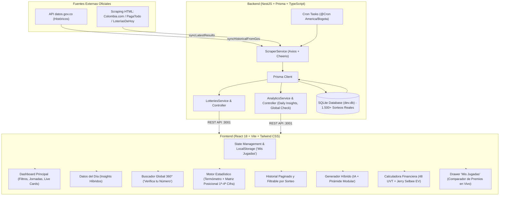

# DataChance CO 🇨🇴 — Plataforma Fintech de Inteligencia Probabilística

[](https://react.dev/)
[](https://www.typescriptlang.org/)
[](https://tailwindcss.com/)
[](https://nestjs.com/)
[](https://www.prisma.io/)
[](https://www.sqlite.org/)
[](https://www.coljuegos.gov.co/)
[](LICENSE)

> **DataChance CO** es una plataforma web moderna de analítica avanzada, finanzas matemáticas y modelos probabilísticos para el ecosistema de loterías tradicionales, chances territoriales, sorteos especiales (*Súper Astro*) y juegos tipo loto (*Baloto y Baloto Revancha*) en Colombia.
>
> Diseñada bajo una estética **Modern Fintech Dark Mode** con tarjetas Glassmorphism, tipografía tabular de alta precisión y un pipeline automatizado de ingesta de datos 100% reales y verificables (cero simulación aleatoria).

---

## 📑 Tabla de Contenidos

- [DataChance CO 🇨🇴 — Plataforma Fintech de Inteligencia Probabilística](#datachance-co----plataforma-fintech-de-inteligencia-probabilística)
  - [📑 Tabla de Contenidos](#-tabla-de-contenidos)
  - [🏛️ Arquitectura del Sistema (Monorepo)](#️-arquitectura-del-sistema-monorepo)
  - [✨ Módulos y Funcionalidades Clave](#-módulos-y-funcionalidades-clave)
    - [1. Dashboard Central de Resultados Oficiales](#1-dashboard-central-de-resultados-oficiales)
    - [2. "Datos del Día" — Análisis Híbrido Focal](#2-datos-del-día--análisis-híbrido-focal)
    - [3. Buscador Global 360° — "Verifica tu Número"](#3-buscador-global-360--verifica-tu-número)
    - [4. Motor de Análisis Probabilístico \& Estadístico](#4-motor-de-análisis-probabilístico--estadístico)
    - [5. Historial de Sorteos Anteriores (Nuevo Módulo)](#5-historial-de-sorteos-anteriores-nuevo-módulo)
    - [6. Generador Híbrido: IA Predictor \& Pirámide Numerológica](#6-generador-híbrido-ia-predictor--pirámide-numerológica)
    - [7. Calculadora Financiera de Premios Colombia (Normativa \& Jerry Selbee)](#7-calculadora-financiera-de-premios-colombia-normativa--jerry-selbee)
    - [8. Mis Jugadas Guardadas con Comparador Automático de Aciertos](#8-mis-jugadas-guardadas-con-comparador-automático-de-aciertos)
  - [🔄 Pipeline de Datos Oficiales y Web Scraping](#-pipeline-de-datos-oficiales-y-web-scraping)
    - [Fuentes de Datos Oficiales](#fuentes-de-datos-oficiales)
    - [Orquestación Automatizada `@Cron`](#orquestación-automatizada-cron)
    - [Normalización y Extracción de Fechas Exactas](#normalización-y-extracción-de-fechas-exactas)
  - [🛠️ Puesta en Marcha Local](#️-puesta-en-marcha-local)
    - [Prerrequisitos](#prerrequisitos)
    - [1. Clonar el Repositorio](#1-clonar-el-repositorio)
    - [2. Backend (NestJS + Prisma + SQLite)](#2-backend-nestjs--prisma--sqlite)
    - [3. Frontend (React + Vite + TypeScript)](#3-frontend-react--vite--typescript)
  - [📡 Endpoints Principales de la API](#-endpoints-principales-de-la-api)
  - [⚖️ Aviso Legal y Declaración de Responsabilidad](#️-aviso-legal-y-declaración-de-responsabilidad)

---

## 🏛️ Arquitectura del Sistema (Monorepo)



---

## ✨ Módulos y Funcionalidades Clave

### 1. Dashboard Central de Resultados Oficiales
- **Filtros por Categoría:** *Chances Diarios*, *Loterías Tradicionales*, *Especiales (Súper Astro)* y *Baloto / Revancha*.
- **Filtros por Jornada Horaria:** *Todo el Día*, *Mañana*, *Tarde* y *Noche*, permitiendo ubicar sorteos vespertinos o nocturnos al instante.
- **Buscador en Tiempo Real:** Filtrado rápido por nombre de lotería o código.
- **Diseño Glassmorphism Fintech:**
  - **Chances y Loterías:** 4 cifras tabulares de alto impacto + serie de 3 dígitos o signo zodiacal.
  - **Baloto / Revancha:** 5 balotas rojas/azules de alta definición + Superbalota dorada neón (`#F59E0B`) con desglose de acumulado multimillonario.

### 2. "Datos del Día" — Análisis Híbrido Focal
- Sección destacada con los sorteos colombianos de mayor volumen (*Sinuano Día/Noche, Dorado Mañana/Tarde, Chontico Día/Noche, Antioqueñita, Paisita, Pijao de Oro*).
- **Métricas Avanzadas:**
  - Promedio de días de rezago de la combinación sugerida.
  - Balance Paridad (e.g. 50% Par / 50% Impar).
  - Score de Afinidad Posicional calculado sobre la matriz de 4 cifras.
  - Número Fusión del Día listo para copiar o guardar en "Mis Jugadas".

### 3. Buscador Global 360° — "Verifica tu Número"
- Permite escribir cualquier número de 4 cifras (o terminación) y consultar en toda la base de datos histórica:
  - Frecuencia total de apariciones exactas de 4 cifras.
  - Fecha y días transcurridos desde su última caída en cualquier sorteo del país.
  - Frecuencias de acierto por modalidad complementaria: **Pata** (últimas 2 cifras) y **Uña** (última cifra).
  - Desglose detallado por loterías y chances donde ha caído con mayor repetición.
  - Registro de ocurrencias históricas con fecha exacta y serie.
  - Botón directo para **Guardar Jugada** y hacerle seguimiento.

### 4. Motor de Análisis Probabilístico & Estadístico
*(Mantenido al 100% de su diseño y rigor matemático original)*:
- **Selector de Sorteo a Examinar:** Permite auditar cualquiera de los 35+ sorteos de Colombia.
- **Termómetro de Números:**
  - *Dígitos Calientes:* Los 5 dígitos (0-9) con mayor frecuencia acumulada en el rango temporal seleccionado.
  - *Dígitos Fríos / Rezagados:* Los dígitos con más sorteos consecutivos sin aparecer.
- **Matriz de Calor por Posición (1ª a 4ª Cifra):**
  - Malla bidimensional completa (dígitos 0 al 9 en filas, 1ª, 2ª, 3ª y 4ª cifra en columnas).
  - Gradiente térmico inteligente que resalta visualmente las posiciones con mayor concentración de apariciones.
- **Gráficos Específicos para Juegos Especiales:**
  - *Súper Astro:* Gráfico Donut con la distribución histórica de los 12 signos zodiacales.
  - *Baloto y Revancha:* Gráfica de barras y ranking de las balotas principales (1-43) y Superbalota (1-16).

### 5. Historial de Sorteos Anteriores (Nuevo Módulo)
Ubicado estratégicamente justo debajo de la Matriz de Calor posicional y conectado al sorteo en análisis:
- **Paginación Fluida:** Navegación página por página (20 registros por página) con indicador de total de registros.
- **Búsqueda Dinámica Multimodal:** Búsqueda en tiempo real por número completo de 4 cifras, *pata* (2 cifras), *uña* (1 cifra), serie o signo zodiacal.
- **Filtro por Rango de Fechas:** Permite aislar sorteos entre una fecha inicial y final.
- **Tabla Estilo Fintech:**
  - Fecha del sorteo formateada en español.
  - Badge visual de *Días transcurridos* (`Hoy`, `Ayer`, o `Hace X días`).
  - Número de 4 cifras resaltado con espaciado monoespaciado.
  - Serie de 3 cifras o signo zodiacal en pill dorado.

### 6. Generador Híbrido: IA Predictor & Pirámide Numerológica
Combina dos mundos: la sabiduría popular y el rigor estadístico de datos en SQLite:
- **Modo 100% Estadístico:** Genera combinaciones ponderadas por frecuencias reales de dígitos calientes con paridad equilibrada.
- **Pirámide Numerológica Colombiana:**
  - Algoritmo de reducción modular (`(a + b) % 10`) a partir de la fecha seleccionada.
  - Representación visual interactiva en niveles piramidales.
  - Extracción automática de números de cúspide, diagonales y base.
- **Fusión Inteligente:** Cruza los números de la pirámide con la matriz de probabilidad de la base de datos, calculando un índice de confianza porcentual y métricas de paridad.
- **Micro-interacciones:** Botón de copiado con disparo de confeti interactivo y botón de guardado en "Mis Jugadas".

### 7. Calculadora Financiera de Premios Colombia (Normativa & Jerry Selbee)
Módulo financiero interactivo dividido en dos pestañas pedagógicas:

#### Pestaña A — Cálculo de Ganancia Real (Normativa Oficial Coljuegos / DIAN)
- **Modalidades Oficiales:**
  - 4 Cifras Directo: **4.500x**
  - 4 Cifras Combinado: **208x**
  - 3 Cifras Directo / Pata: **400x**
  - 2 Cifras / Uña: **50x**
  - Súper Astro: **42.000x** (4 cifras + signo) o **1.000x** (3 cifras + signo).
  - Baloto / Revancha: Simulación de pozo acumulado multimillonario.
- **Desglose Fiscal Riguroso:**
  - **Ganancia Bruta:** Monto apostado × multiplicador oficial.
  - **Retención en la Fuente por Ganancia Ocasional (20%):** Aplicada de forma estricta únicamente si la ganancia bruta supera las **48 UVT** vigentes (UVT 2026: **$49.799 COP**, umbral de exención: **$2.390.352 COP**). Si no supera el tope, se liquida exactamente `$0 COP (Exento)`.
  - **Pago Neto Real:** Efectivo líquido que el usuario recibe en caja o transferencia bancaria.

#### Pestaña B — Análisis Matemático (Método Jerry Selbee)
- **Probabilidad Teórica Exacta:** Cálculo combinatorio exacto (`1 en 10.000` para 4 cifras directo, `1 en 15.401.568` para Baloto, etc.).
- **Valor Esperado (EV) & Retorno Teórico al Jugador (RTP %):**
  - Indicador visual tipo pill que señala si la ventaja matemática está a favor de la casa o del jugador.
- **Simulador Interactivo de "Escenario Rolldown":**
  - Slider interactivo para experimentar cómo incrementos extraordinarios en el pozo o multiplicadores especiales empujan el **Valor Esperado a terreno positivo (`EV > $0 COP`)**, emulando el descubrimiento del matemático Jerry Selbee en loterías de pozo rodante.

### 8. Mis Jugadas Guardadas con Comparador Automático de Aciertos
- Drawer lateral persistido en `localStorage` (sin necesidad de registro de cuentas).
- Permite almacenar números de jugada con nombre del sorteo, fecha objetivo y modalidad.
- **Auditoría Automática de Premios:**
  - Al abrir el drawer, el sistema cruza en tiempo real cada jugada guardada contra los resultados ganadores oficiales de hoy.
  - Identifica y resalta con insignias doradas aciertos en:
    - 🎯 **Premio Directo:** Coincidencia de las 4 cifras.
    - 🥈 **Pata (2 Cifras):** Coincidencia de las 2 últimas cifras.
    - 🥉 **Uña (1 Cifra):** Coincidencia de la última cifra.
    - 🪐 **Astro Signo:** Acierto en 4 o 3 cifras más signo zodiacal.
    - 🔴 **Baloto:** Coincidencia de balotas principales y Superbalota.

---

## 🔄 Pipeline de Datos Oficiales y Web Scraping

```
[ datos.gov.co API ] ─────────► [ syncHistoricalFromGov() ] ──┐
                                                              ▼
[ colombia.com ] ─────────────► [ syncLatestResults() ] ────► [ SQLite dev.db ]
[ loteriasdehoy.co ] ─────────► [ parseSpanishDate() ]        (Cero Math.random)
[ pagatodo.com.co ] ──────────► [ timezone: Bogota ]          
```

### Fuentes de Datos Oficiales
1. **Portal de Datos Abiertos del Estado Colombiano (`datos.gov.co`):** Ingesta masiva de resultados históricos verificados de loterías como Lotería de Medellín, Bogotá, Boyacá, Cruz Roja, Santander, Cundinamarca, entre otras.
2. **Portales Oficiales y de Concesionarios de Lotería:** Web scraping en tiempo real con `axios` y `cheerio` hacia `colombia.com`, `loteriasdehoy.co` y `pagatodo.com.co` con rotación de cabeceras `User-Agent`.

### Orquestación Automatizada `@Cron`
El backend ejecuta tareas periódicas configuradas en la zona horaria oficial `America/Bogota` (`cron: 0 */30 11-23 * * *`):
- **11:00 AM – 1:30 PM COT:** Sincronización de sorteos matutinos (Dorado Mañana, Chontico Día, Antioqueñita 1).
- **2:00 PM – 5:30 PM COT:** Sincronización de sorteos vespertinos (Sinuano Día, Paisita 1, Pijao de Oro).
- **8:00 PM – 11:45 PM COT:** Sincronización de loterías mayores nocturnas (Medellín, Boyacá, Bogotá, etc.), Súper Astro Luna, Chontico Noche y Baloto/Revancha (miércoles y sábados).

### Normalización y Extracción de Fechas Exactas
- El parser `parseSpanishDate` extrae la fecha nativa de publicación del sorteo desde el HTML fuente (evitando desfases de huso horario o retrasos de medianoche entre la noche del sorteo y la mañana siguiente).
- Configura las horas UTC proporcionales a la jornada (`10:30` Mañana, `14:30` Tarde, `22:30` Noche en horario Colombia).

---

## 🛠️ Puesta en Marcha Local

### Prerrequisitos
- **Node.js:** Versión 18.0 o superior (recomendado Node 20 LTS).
- **npm** o **pnpm**.
- Sistema Operativo: Windows, macOS o Linux.

---

### 1. Clonar el Repositorio
```bash
git clone https://github.com/tu-usuario/datachance-co.git
cd datachance-co
```

---

### 2. Backend (NestJS + Prisma + SQLite)

```bash
cd backend

# Instalar dependencias
npm install

# Generar cliente de Prisma y ejecutar migraciones SQLite
npx prisma generate
npx prisma migrate dev --name init

# (Opcional) Ejecutar seed inicial de catálogo de sorteos
npx prisma db seed

# Compilar proyecto TypeScript
npm run build

# Iniciar servidor en modo desarrollo o producción
npm run start:dev
# O con build previo:
npm run start
```

El servidor backend estará escuchando en:
👉 `http://localhost:3001/api`

#### Sincronización Inicial de Datos Reales (Opcional manual)
Para forzar una sincronización inmediata desde la API de Datos Abiertos y scraping web:
```bash
curl -X POST http://localhost:3001/api/scraper/sync-all
```

---

### 3. Frontend (React + Vite + TypeScript)

En una nueva terminal:
```bash
cd frontend

# Instalar dependencias
npm install

# Iniciar servidor de desarrollo Vite con Hot Module Replacement (HMR)
npm run dev
```

La aplicación web estará disponible de inmediato en:
👉 `http://localhost:5173` (o `http://127.0.0.1:5173`)

Para compilar el frontend listo para producción:
```bash
npm run build
npm run preview
```

---

## 📡 Endpoints Principales de la API

| Método | Endpoint | Descripción | Parámetros / Query |
| :--- | :--- | :--- | :--- |
| `GET` | `/api/lotteries` | Lista de todas las loterías y chances con su último resultado | `category`, `search` |
| `GET` | `/api/lotteries/:slug` | Detalle de un sorteo por slug | — |
| `GET` | `/api/lotteries/:slug/history` | **Historial paginado y filtrable** de sorteos pasados | `page`, `limit`, `search`, `startDate`, `endDate` |
| `GET` | `/api/analytics/frequency/:slug` | Análisis de dígitos calientes, fríos y matriz de posición | `days` (30, 90, 365) |
| `GET` | `/api/analytics/daily-insights/:slug` | Insights híbridos del día (afinidad, paridad, rezago) | — |
| `GET` | `/api/analytics/check-number/:number` | **Buscador global 360°** de frecuencia, pata, uña y loterías | `:number` (4 cifras) |
| `GET` | `/api/analytics/baloto` | Frecuencias históricas de balotas (1-43) y Superbalota (1-16) | — |
| `POST`| `/api/scraper/sync-all` | Ejecuta ingesta de datos.gov.co y portales oficiales | — |
| `GET` | `/api/scraper/status` | Estado de la base de datos y total de sorteos reales | — |

---

## ⚖️ Aviso Legal y Declaración de Responsabilidad

1. **Propósito Informativo y Educativo:** **DataChance CO** es una herramienta tecnológica independiente de análisis de datos, visualización estadística y educación financiera basada en matemáticas probabilísticas. No es una casa de apuestas, concesionario de chance ni plataforma transaccional de juegos de azar.
2. **Cumplimiento Normativo:** Los juegos de suerte y azar en Colombia están regulados por **Coljuegos** bajo el marco de la **Ley 643 de 2001** y normas concordantes.
3. **Independencia de Sorteos:** Los sorteos de lotería y chances son eventos físicos e independientes gobernados por el azar. Las estadísticas históricas, las frecuencias pasadas y los modelos generativos reflejan tendencias observadas en datos pasados y **en ningún caso constituyen una garantía de ganancias o resultados futuros**.
4. **Juego Responsable:** Promovemos el juego responsable y moderado. Las apuestas son actividades exclusivas para **mayores de 18 años**. Si usted o alguien cercano experimenta dificultades con el control de las apuestas, consulte los canales de apoyo para la prevención de la ludopatía autorizados en Colombia.

---

Desarrollado con ❤️ para la comunidad de analítica y datos de Colombia.
